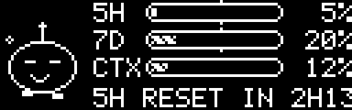

# claude-oled

Show your **Claude Code** usage limits live on the OLED screen of a SteelSeries keyboard
(Apex Pro, Apex Pro TKL, Apex 7 and other boards with a 128×40 display) – with a little
animated mascot that reacts to how much of your quota is left.



## What it shows

| Row | Meaning |
|---|---|
| **5H** | Usage of the current 5-hour session window |
| **7D** | Usage of the weekly limit |
| **CTX** | How full the context window of the active session is |
| ticker | Time until the next resets, model, session cost |

The small tick above/below the 5H and 7D bars marks how much of the time window has already
passed. If the bar is ahead of the tick, you are burning through the quota faster than time runs.

**Bit**, the mascot on the left, changes its mood:

| Mood | When |
|---|---|
| happy | less than 40 % used |
| content | 40–75 % |
| worried, sweating | from 75 % of any limit |
| panicking, shaking, percentage blinks | from 95 % |
| asleep (Zz) | no activity for 10 minutes |

While Claude Code is working, Bit bounces, its antenna sparkles and the bar stripes move.

## How it works

Claude Code pipes a JSON object into a configurable
[status line command](https://code.claude.com/docs/en/statusline) after each update.
It contains, among other things, `rate_limits.five_hour` / `rate_limits.seven_day`
(`used_percentage`, `resets_at`), `context_window.used_percentage`, the model and the session cost.

```
Claude Code ──stdin JSON──▶ claude-oled statusline ──▶ ~/.claude/oled-state.json
                                                              │
SteelSeries GG ◀──GameSense HTTP (localhost)── claude-oled run ┘
```

* `claude-oled statusline` stores that data and prints a normal status line.
* `claude-oled run` reads the file, renders a 128×40 bitmap at 8 fps and sends it to
  SteelSeries GG via the official [GameSense SDK](https://github.com/SteelSeries/gamesense-sdk).
  The server address is read from `coreProps.json`.

No network access besides `127.0.0.1`, no dependencies outside the Go standard library.

### Limitations

* **Percentages, not tokens.** For Pro/Max plans only the utilisation in percent is exposed,
  not absolute token budgets.
* `rate_limits` is only present when you are logged in with a Claude subscription (Pro/Max).
  With an API key the bars show `--`.
* Values update whenever Claude Code redraws its status line. When you are idle the last values
  stay on screen; after a reset time has passed the bar drops to 0 % automatically.
* With several sessions open, CTX shows the most recently active one.

## Installation (Windows)

1. Download `claude-oled-windows-amd64.exe` from the
   [latest release](../../releases/latest), rename it to `claude-oled.exe` and put it in a folder
   such as `C:\Users\<you>\claude-oled\`.
2. Make sure SteelSeries GG is running, then test: `claude-oled.exe demo`
   – the OLED should show animated sample data. Stop with Ctrl+C.
3. Add the status line to `%USERPROFILE%\.claude\settings.json`:
   ```json
   {
     "statusLine": {
       "type": "command",
       "command": "C:/Users/<you>/claude-oled/claude-oled.exe statusline"
     }
   }
   ```
4. Start the renderer at login without a console window: create a shortcut in `shell:startup`
   with the target
   ```
   C:\Windows\System32\conhost.exe --headless "C:\Users\<you>\claude-oled\claude-oled.exe" run
   ```

### Using Claude Code inside WSL

Claude Code in WSL reads its own `~/.claude/settings.json`. Point it at the **Windows** executable;
WSL interop runs it and it writes the state file to the Windows profile, where the renderer reads it:

```json
{
  "statusLine": {
    "type": "command",
    "command": "/mnt/c/Users/<you>/claude-oled/claude-oled.exe statusline"
  }
}
```

### Keeping an existing status line

```
claude-oled statusline --chain "<your previous status line command>"
```
The JSON is forwarded to your command and its output is shown instead of the built-in one.

### macOS

Use `claude-oled-macos-arm64` or `-amd64`, put it in your `PATH` (e.g. `/usr/local/bin/claude-oled`),
remove the quarantine flag with `xattr -d com.apple.quarantine /usr/local/bin/claude-oled`, then
follow steps 2–3. For autostart use a LaunchAgent that runs `claude-oled run`.

### Antivirus false positives

Some antivirus products flag unsigned Go binaries heuristically. The source is small and
readable; if you prefer, build it yourself (see below) or verify the release with `SHA256SUMS.txt`.

## Commands

| Command | Purpose |
|---|---|
| `claude-oled statusline [--chain "<cmd>"]` | Status line hook for Claude Code |
| `claude-oled run` | Renderer / GameSense daemon |
| `claude-oled demo` | Animated sample data on the OLED |
| `claude-oled preview [file.gif]` | Render current state as ASCII (and optionally a GIF) |
| `claude-oled showcase [file.gif]` | GIF cycling through all moods |
| `claude-oled remove` | Unregister the app from SteelSeries GG |
| `claude-oled version` | Print version |

Environment variables: `GAMESENSE_ADDRESS` (host:port, skips `coreProps.json`),
`GAMESENSE_COREPROPS`, `CLAUDE_OLED_STATE_DIR`, `CLAUDE_OLED_CHAIN`.

## Building

Requires Go 1.24+.

```
go build -o claude-oled .
GOOS=windows GOARCH=amd64 go build -o claude-oled.exe .
```

Releases are built by GitHub Actions when a `v*` tag is pushed.

## Disclaimer

Not affiliated with or endorsed by SteelSeries or Anthropic. "Claude" and "Claude Code" are
trademarks of Anthropic; "SteelSeries", "Apex" and "GameSense" are trademarks of SteelSeries.

## License

MIT – see [LICENSE](LICENSE).
